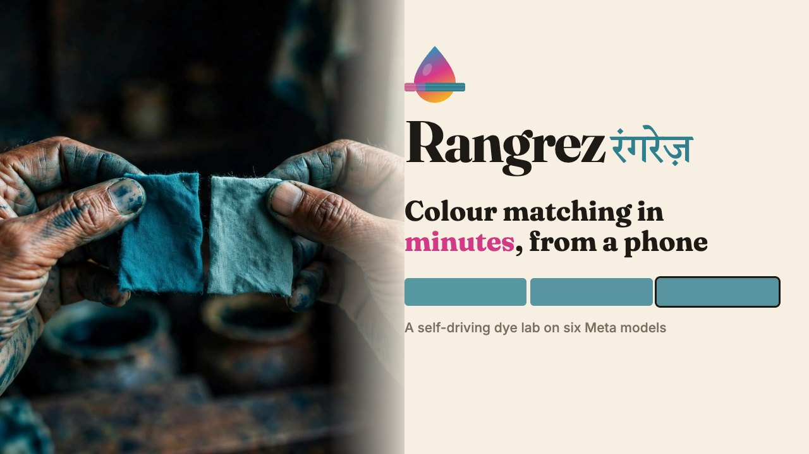
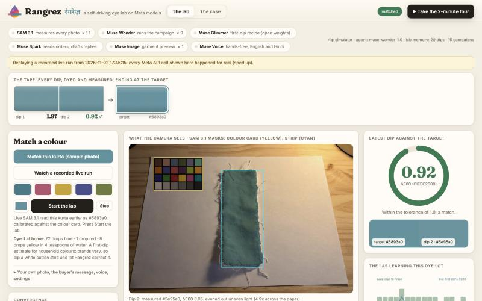
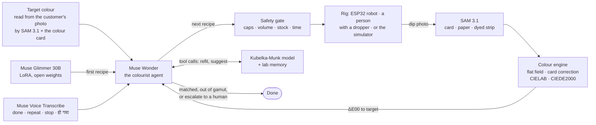
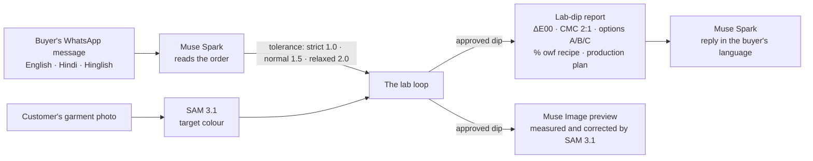

<p align="center"></p>

<h1 align="center">Rangrez <sub>रंगरेज़</sub></h1>

<p align="center"><b>A self-driving dye lab on Meta models.</b><br>Show it a colour. It picks a recipe, a cotton strip is dyed, a phone photographs it, and it corrects the recipe until the cloth matches.</p>

<p align="center"><a href="https://youtu.be/g4Z30UhPtjA"></a><br><sub>▶ <a href="https://youtu.be/g4Z30UhPtjA">Watch the 3-minute demo</a></sub></p>

## Quick links

| | |
| --- | --- |
| ▶ **3-minute demo video** | [youtu.be/g4Z30UhPtjA](https://youtu.be/g4Z30UhPtjA) |
| **Live app** (Hugging Face Space) | [huggingface.co/spaces/TechTush/rangrez](https://huggingface.co/spaces/TechTush/rangrez) |
| A recorded live run, replayed in the app | […/rangrez?replay=1](https://huggingface.co/spaces/TechTush/rangrez?replay=1) |
| The 2-minute guided tour | […/rangrez?tour=1](https://huggingface.co/spaces/TechTush/rangrez?tour=1) |
| **Open weights:** Muse Glimmer 30B LoRA | [TechTush/rangrez-glimmer-lora](https://huggingface.co/TechTush/rangrez-glimmer-lora) |
| **Dataset:** 2,900 lab dips | [TechTush/rangrez-lab-dips](https://huggingface.co/datasets/TechTush/rangrez-lab-dips) |
| Source code | [github.com/TusharTechs/rangrez](https://github.com/TusharTechs/rangrez) |
| Architecture diagram | [Architecture](#architecture) |
| Run it on Windows, macOS or Linux | [Run it locally](#run-it-locally) |
| Results and benchmarks | [Does it work?](#does-it-work-on-real-looking-photos) · [Glimmer](#glimmer-the-labs-first-dip) |
| Robot rig: parts, wiring, firmware | [hardware/BUILD.md](hardware/BUILD.md) · [firmware](firmware/rangrez_rig/rangrez_rig.ino) |



> **Where it stands today.** The software, agent and Meta model stack are built and tested end to end. The $100 robot rig is designed (firmware, wiring, and a virtual ESP32 that runs the real driver) but not yet built. Every result below comes from a simulator: hidden dye chemistry, plus real-looking phone photos made with Muse Image and recoloured to known truth. No real dye on real cloth yet; the measured numbers say so wherever they appear.

**In one minute.**
- **Six Meta models, six jobs:**
  - SAM 3.1 measures every photo;
  - Muse Wonder runs the lab;
  - Muse Glimmer (fine-tuned, open weights) proposes the first dip;
  - Muse Spark reads the buyer's WhatsApp order and drafts the reply;
  - Muse Image previews the garment;
  - Muse Voice Transcribe takes hands-free commands in English or Hindi.
- **Measurement:** 0.66 ΔE00 median error from a phone photo with a printed colour card.
- **Matching:** 24/24 shades matched in a median of 2 dips; lab memory cut the first dip's error from 3.81 to 1.40 over a 40-campaign night shift.
- **Why an agent:** Muse Wonder matched 8 of 8 live campaigns. A fixed policy with the same tools and safety rules matched 5, because it couldn't recover from an overshoot.
- **Safety:** a deterministic gate, repeated in the firmware, means the model never drives a pump.
- **Output:** every campaign ends in the document the buyer actually asks for: a lab-dip report with ΔE00 and CMC 2:1, options A/B/C, the recipe in % on weight of fabric and a production plan.

*Rangrez* (रंगरेज़) means *dyer*.

## For judges: where to look

| Criterion | Where to see it |
| --- | --- |
| **Impact** | [Why](#why): lab dips take 2–4 rounds of several days; small dye houses match by eye. The app's *The case* tab covers adoption, cost and honest limits. |
| **Meta tooling** | Six models with six jobs, [listed below](#architecture). Every call is shown live on the dashboard's model chips and recorded with its timing. Muse Glimmer was fine-tuned and its weights published. |
| **Technical depth** | Colour measurement from a phone (flat-field from the paper, 24-patch card correction, CIEDE2000 checked against colour-science), Kubelka-Munk dye model, a safety gate repeated in [firmware](firmware/rangrez_rig/rangrez_rig.ino), [124 tests](#run-it-locally), and honest baselines that beat our own fine-tune. |
| **Demo** | The [video](https://youtu.be/g4Z30UhPtjA), the [live app](https://huggingface.co/spaces/TechTush/rangrez), or a [recorded live run](https://huggingface.co/spaces/TechTush/rangrez?replay=1) with every real Meta API call. |
| **Agentic** | Muse Wonder matched 8/8 live campaigns; a fixed policy with the same tools matched 5/8 ([table](#does-it-work-on-real-looking-photos)). |
| **Open weights** | [Glimmer LoRA](https://huggingface.co/TechTush/rangrez-glimmer-lora) and [dataset](https://huggingface.co/datasets/TechTush/rangrez-lab-dips), trained on Modal, with the training and evaluation code in `eval/`. |

## Why

A textile buyer approves a shade by "lab dip": the dye house mixes a recipe, dyes a swatch, and sends it for approval. If the buyer rejects it, the house corrects and dyes again. Each round costs days. Large mills use spectrophotometers and colour-matching software; the thousands of small dye houses in Tiruppur, Surat, Erode and Bhiwandi mostly use experience and repeated trials.

Rangrez automates the colourist's loop on a phone camera and an old-fashioned set of pumps: recipe, dip, measure, correct.

## Architecture

**The lab loop.** One campaign, from a target colour to a matched dip.



**Around the loop.** From the buyer's message to the documents they get back.



The loop: **recipe → gate → dye a strip → photograph → SAM 3.1 masks → calibrated colour → ΔE00 → refit and correct**, until the measured difference is inside the buyer's tolerance, the shade is out of the dyes' gamut, or three dips fail to improve and a human takes over. The model reasons; the numbers come from tested code; the hardware obeys only the gate and the firmware.

### The six Meta models

| Meta model | Job |
| --- | --- |
| **SAM 3.1** | Text-prompted segmentation of the 24-patch colour card and the dyed cotton in every frame. The pixels inside the masks become a calibrated colour measurement, so SAM works as a measuring instrument. It also reads the colour of a named object ("kurta") in a customer's photo |
| **Muse Wonder** | Runs the campaign through tool calls: suggests recipes, refits the dye model, writes the lab notebook, decides when to stop or escalate |
| **Muse Image** | Bulk preview: recolours the customer's garment photo to the approved dip's shade. Rangrez measures the preview with SAM 3.1 and corrects it, because an image model is not a colour instrument: one raw preview measured 11 ΔE00 from the dip. The corrected preview is checked by the same instrument that corrected it, so treat it as a picture, not a measurement. It also generated the realistic test scenes |
| **Muse Voice Transcribe** | Hands-free lab in English or Hindi: the dyer says "done", "repeat" or "stop" ("हो गया", "फिर से", "बंद करो"), or describes what they see |
| **Muse Spark** | Reads the buyer's message into an order: quantity, fabric, dates and shade strictness, which sets the pass tolerance and the production plan |
| **Muse Glimmer 30B** (open weights, fine-tuned) | Proposes each campaign's first dip from the lab's own records. First-dip error falls from 4.10 (the supplier's model) to 0.92 ΔE00; a Gaussian process on the same data reaches 0.77, so Glimmer v2 reads the lab's notebook instead. The weights are published |

### Engineering choices

- **The model never drives a pump.** Every recipe passes a deterministic gate (concentration caps, bath volume, stock levels, dip time). The ESP32 firmware enforces the same limits again, behind a hardware e-stop.
- **Numbers come from tools, not from prose.** Colour maths (CIELAB, CIEDE2000, colour-card correction, Kubelka-Munk) is plain, tested code; the agent reasons over its results.
- **It learns this dye lot.** After every dip the dye model refits per-dye uptake. Near the target, Rangrez switches to a colourist-style correction: it takes the best real dip and corrects it by its measured error, using the refitted model's sensitivity. The model alone always predicts a perfect match, but no model captures everything (saturation, lot strength).
- **It knows what it can't do.** If dips at the safety cap still miss, the shade is outside this dye set's gamut. Rangrez stops and reports the closest dip instead of wasting cotton.
- **It escalates.** Three dips without real improvement (beyond measurement noise) hand control back to a human.
- **It evens out the light.** A desk lamp, a window or a shadow lights the strip and the card unequally. Rangrez fits the light across the frame from the white paper, ignoring cast shadows, and divides it out before measuring. If the light is too steep (a phone flash), or the card is unreadable, it says so and asks for a retake, or falls back to the paper.
- **It compares side by side.** If the customer's cloth lies beside the strip in the dip photo, Rangrez compares the two under the same light and re-anchors the target to that reading. A target read from a photo taken elsewhere carries that photo's light and camera error; the side-by-side reading does not.
- **It ignores the bedsheet.** SAM's "fabric" also finds the bedsheet or tablecloth under the paper. Only cloth lying on the paper is measured.
- **It remembers the dye lot.** Every dip goes into the lab's memory. Each new campaign starts from a model fitted to all of them and is offered the most similar past dip, corrected towards the new target. Over a night shift of 40 campaigns, the first dip's true error fell from 3.81 to 1.40 ΔE00 and dips per match from 2.35 to 1.65 (`eval/night_shift.py`, chart in `eval/night_shift.png`).
- **It talks to the buyer's language.** Every campaign produces a lab-dip report, the document a dye house sends for shade approval:
  - target against the submitted dip;
  - ΔE00 split into ΔL*, ΔC* and ΔH*, with a verdict in plain words such as "slightly darker, greener";
  - the recipe scaled for 1 kg of cotton;
  - every dip with its photo and SAM's masks;
  - a line for the buyer's signature.
- **Hands-free, in English or Hindi.** The dyer's gloves are wet with dye. In hands-free mode the dashboard reads each dip's instructions aloud and listens through Muse Voice Transcribe:
  - English: "done", "repeat", "stop";
  - Hindi: "हो गया", "फिर से", "बंद करो".
  Anything else, such as "it looks patchy near the top" or "कपड़ा ऊपर से धब्बेदार है", goes into the notebook for Wonder. Nothing spoken can dispense dye.
- **It reads the order.** Muse Spark turns the buyer's chat message, in English or Hindi, into a structured order: garment, quantity, fabric, dates and how strict the shade is. The strictness sets the pass tolerance: strict 1.0, normal 1.5, relaxed 2.0 ΔE00. The approved recipe then scales to a production plan for the order: cotton, dye bath, grams of each dye, salt and soda ash.
- **No single photo decides a pass.** On an automated rig, a dip that passes is photographed again, and both readings must agree.
- **It measures cloth, not liquid.** A cup of dye does not predict the shade on fabric, so every reading is taken on a dried, dyed cotton segment.

## Run it locally

Rangrez runs on **Windows, macOS and Linux** with Python 3.12+. [uv](https://docs.astral.sh/uv/) installs the right Python and every dependency from the lock file. No API key and no hardware are needed: without a key, the full loop runs in the built-in simulator with an offline policy and SAM masks cached for each scene.

**macOS and Linux**

```bash
curl -LsSf https://astral.sh/uv/install.sh | sh        # once
git clone https://github.com/TusharTechs/rangrez.git
cd rangrez
uv sync
uv run rangrez-lab
```

**Windows (PowerShell)**

```powershell
powershell -ExecutionPolicy ByPass -c "irm https://astral.sh/uv/install.ps1 | iex"   # once, then open a new terminal
git clone https://github.com/TusharTechs/rangrez.git
cd rangrez
uv sync
uv run rangrez-lab
```

Open **http://127.0.0.1:8000** and press *Match this kurta*, *Watch a recorded live run*, or *Take the 2-minute tour*.

**Docker (any OS)**

```bash
docker build -f space/Dockerfile -t rangrez .
docker run -p 7860:7860 rangrez                         # http://127.0.0.1:7860
```

**With the Meta models.** Copy the example settings and add your Meta Model API key. `.env` is read on every OS, so it is also the easiest place for the other settings below.

```bash
cp .env.example .env            # Windows: copy .env.example .env
# set MODEL_API_KEY=... in .env, then
uv run rangrez-lab
```

With a key, SAM 3.1 measures every photo and Muse Wonder runs the campaign; Muse Spark, Muse Image and Muse Voice Transcribe light up when you use the order box, the preview and hands-free mode. Glimmer's first dip needs `GLIMMER_BASE_URL` and `GLIMMER_API_KEY` (serve the published weights with `eval/glimmer_serve.py`); the lab works without it.

Or try it with nothing installed: [huggingface.co/spaces/TechTush/rangrez](https://huggingface.co/spaces/TechTush/rangrez). Photograph your outfit: SAM 3.1 reads its colour and Rangrez gives a recipe to dye a matching cloth at home, in drops of blue, red and yellow household colour.

### Run it at home for free (assisted mode)

You can run the lab with no hardware: you are the pumps and your phone is the camera.

| Need | Free option |
| --- | --- |
| Colours | Blue, red and yellow sketch-pen ink or food colour |
| Cloth | Strips of an old white cotton T-shirt or handkerchief |
| Measuring | Count drops with a dropper or straw |
| Reference | A sheet of white paper; the printed colour card is better if you have one |
| Camera | Your phone (upload, or streaming as an IP webcam) or a laptop webcam / Continuity Camera |

Set the mode in `.env` (works on every OS), or inline:

```bash
RANGREZ_RIG=assisted RANGREZ_DYES=home RANGREZ_HOST=0.0.0.0 uv run rangrez-lab        # macOS, Linux
```

```powershell
$env:RANGREZ_RIG="assisted"; $env:RANGREZ_DYES="home"; $env:RANGREZ_HOST="0.0.0.0"; uv run rangrez-lab   # Windows
```

1. Open the dashboard on your laptop, or from your phone at `http://<laptop-ip>:8000`.
2. Photograph your target cloth on the paper and press "Read colour with SAM 3.1".
3. Start the campaign. For every dip the dashboard tells you the drops of each colour and the dip time.
4. Dip, dry, lay the strip on the same paper under the same light, and send the photo. If you have the customer's cloth, lay it beside the strip.
5. SAM 3.1 measures it and Muse Wonder decides the next dip.

Photos can be JPEG, PNG or iPhone HEIC, any orientation. `RANGREZ_CAMERA` picks the "Use webcam" source: a webcam index (`0`, `1`), a phone streaming as an IP webcam (`http://192.168.1.7:8080/video`), or a video file.

Without the colour card, Rangrez white-balances against the paper. Absolute colour can then be off by up to about 5 ΔE00. Matching still works, because the target and every dip are photographed on the same paper under the same light, so the error is shared. Every reading says which calibration it used.

On the real rig, see [hardware/BUILD.md](hardware/BUILD.md):

```bash
RANGREZ_RIG=serial RANGREZ_PORT=/dev/cu.usbserial-0001 uv run rangrez-lab   # macOS; Linux: /dev/ttyUSB0; Windows: COM3
```

Without the parts, run the same driver against a virtual ESP32. It speaks the firmware's protocol on a pseudo serial port, with the hard limits read from the `.ino` itself, and has a light-box webcam that records video:

```bash
RANGREZ_RIG=serial RANGREZ_PORT=virtual uv run rangrez-lab
```

The virtual board needs a POSIX pseudo terminal: macOS, Linux, or WSL on Windows.

Every campaign is recorded to `recordings/<time>_<rig>/`:
- the customer's photo;
- every dip photo, with and without SAM's masks;
- every event: each Meta API call with its timing, Wonder's notes and tool calls, and each measurement.

`uv run python eval/demo_reel.py recordings/<run>` turns a run into a 1080p clip. `eval/home_reel.py` cuts a recorded household run into a labelled simulation of a home dye run. The kitchen scenes are Muse Image pictures (`assets/sim/`). The customer's photo, each recipe Wonder chose and why, each dip photo with SAM's masks, and the errors all come from the recording. Every frame says it is a simulation.

Tests:

```bash
uv run pytest
```

`uv run pytest` runs 124 tests offline, with no key and no hardware. On Windows the 8 virtual-ESP32 tests are skipped (they need a POSIX pseudo terminal; run them in WSL). They cover:
- the CIEDE2000 reference pairs;
- colour-card correction;
- the Kubelka-Munk model;
- measurement against known truth on real-looking photos from 11 rooms and lights, with the card, with paper only, and with neither;
- uneven lamp light, a hard phone shadow, a phone flash, a crumpled strip, a card laid over the strip, a bedsheet under the paper, and a customer's kurta;
- a home-printed colour card, phone photos (rotated 12 MP JPEG, PNG, iPhone HEIC), a phone streaming as an IP webcam, and a video-file camera;
- the robot: the real serial driver against the virtual ESP32, which checks the full rinse–pump–stir–dip–dry–photograph sequence, firmware refusals, the e-stop latch, and a campaign matched from webcam video;
- the safety gate;
- convergence on reachable shades, every dip photographed in a different room;
- early stopping on out-of-gamut ones.

## Does it work on real-looking photos?

Every photo in the simulator and in the tests is a real-looking phone photo. Muse Image generated 12 scenes of undyed cotton on printer paper in Indian homes:
- a desk lamp and window daylight;
- a kitchen tube light and a warm evening bulb;
- a phone shadow, a phone flash and a tilted phone;
- a crumpled strip, a strip on a bare table, a bedsheet under the paper, and a kurta.

SAM 3.1 masked each scene once; the masks are cached in `src/rangrez/scenes/masks`. To photograph a dip, the cloth is recoloured to its true colour under the scene's own uneven light, keeping its real folds, weave and shadows. The paper's true whiteness and tint are randomised and hidden from the pipeline, as with real printer paper. Exposure, white balance, sensor noise and JPEG quality vary per photo. `uv run pytest` runs all of this offline.

Measurement with live SAM 3.1, 44 photos (`uv run python eval/accuracy.py`):

| Reference in the photo | Median ΔE00 | p90 |
| --- | --- | --- |
| Printed colour card | 0.66 | 2.3 |
| White paper only | 1.17 | 5.1 |

The worst readings are the phone-flash photos (5–9 ΔE00). Rangrez flags those and asks for a retake without flash. Photos with neither card nor paper are flagged as uncalibrated.

Full assisted campaigns, live SAM 3.1, household drops profile, 8 dips at most (`uv run python eval/campaigns.py wonder`, then `offline`). A simulated person follows the drop counts, hidden chemistry dyes the strip, and each dried strip comes back as a realistic phone photo. The target cloth is photographed first, on the same paper. The same 8 campaigns ran twice, with the same tools, safety gate and stopping rules. Once with Muse Wonder choosing each recipe, and once with a fixed hand-written policy. Each cell gives the dips used and the best dip's true ΔE00.

| Scene | Reference | Muse Wonder | Fixed policy |
| --- | --- | --- | --- |
| Desk lamp | paper | matched, 4 dips, 1.42 | matched, 4 dips, 1.42 |
| Daylight | card | matched, 8 dips, 1.43 | escalated after 7, 3.09 |
| Phone shadow | paper | matched, 4 dips, 1.40 | matched, 4 dips, 1.40 |
| Tilted phone | card | matched, 4 dips, 1.53 | matched, 4 dips, 1.53 |
| Warm bulb, bedsheet | paper | matched, 5 dips, 1.26 | matched, 6 dips, 1.60 |
| Kitchen tube light | card | matched, 5 dips, 2.01 | escalated after 6, 2.98 |
| Crumpled strip | card | matched, 5 dips, 1.20 | matched, 5 dips, 1.20 |
| Bedsheet under paper | paper | matched, 8 dips, 1.81 | escalated after 5, 5.79 |
| **Matched** | | **8 / 8** | **5 / 8** |

Both policies overshot at the same dips: a correction near the dye cap came out worse than the dip before. The fixed policy then made three dips in a row without improving, so the stopping rule handed those three to a human. Muse Wonder read the notebook, changed method, and recovered. The match is called on the measured ΔE00 (under 2.0); in the kitchen case, the measured 1.92 was 2.01 in truth. We tried two hand-written fixes to the fixed policy: halving the step after an overshoot, and switching to the refitted model after one. Each reached 6/8 but lost a household shade in the 24-shade benchmark, so we kept neither. There are 8 campaigns, so treat this as an early sign, not a statistic. There were no failed API calls. These are synthetic photos with simulated chemistry, not real dye on real cloth.

The whole app, end to end through the dashboard's HTTP API and in the browser, live SAM 3.1 and Muse Wonder (`eval/phone_client.py` plays the customer and the person). Every run is recorded:

| Run | Result |
| --- | --- |
| Robot rig (virtual ESP32, light-box webcam video), teal kurta photo | matched in 2 dips: 3.6 → 1.4 |
| Robot rig, plum beyond 10 g/L fuchsia | out of gamut after 2 dips at the cap, closest dip reported |
| Assisted, household drops, kurta photo, the cloth beside every dip | matched in 6 dips; true error 1.5 (the same scenario without the cloth beside the dips ended 7.2 off: the kurta photo and the dips were taken in different rooms) |
| Assisted, household drops, teal | escalated to a human after 3 dips without improvement |
| Assisted, household drops, indigo, cloth beside | 10 dips, best true error 2.8: no match within 2.0 |

Offline benchmark of the same tools, 24 shades each, every dip a realistic photo in a different room (`eval/benchmark.py`): reactive dyes on the robot rig matched 24/24 in a median of 2 dips. Household drops matched 19/24 in a median of 6. Household inks are a rough stand-in, measured in whole drops; strong blue-heavy shades are where they stall.

Reading a garment's colour from a customer's photo is the weakest step. A folded kurta covers half the paper, so the light under it has to be guessed from the paper around it, and live readings were 2.7–3.9 ΔE00 off even with the card. Lay the customer's cloth beside the strip whenever you have it.

## Glimmer: the lab's first dip

The supplier's model knows the dyes in general, not this dye lot through this camera. Muse Glimmer 30B was fine-tuned with LoRA on the lab's own records: 2,900 dips, each the recipe dipped and the colour SAM 3.1 measured on the cloth in a real-looking photo. Its first recipes were then scored on 100 held-out targets by the colour they really dye (`uv run python eval/glimmer.py score <run>`):

| First dip from | Median ΔE00 | p90 | Under 3 |
| --- | --- | --- | --- |
| Supplier model (the lab's default) | 4.10 | 8.52 | 38% |
| Classical model refitted to 400 of the lab's dips | 2.05 | 3.56 | 78% |
| Muse Glimmer 30B, base | 11.38 | 19.40 | 8% (40 answers still reasoning at 2,048 tokens) |
| Muse Glimmer 30B, LoRA on Fireworks Serverless Training | 1.59 | 3.46 | 88% |
| **Muse Glimmer 30B, LoRA on Modal (published weights)** | **0.92** | **1.76** | **96%** |
| Muse Glimmer 30B, LoRA v2 that also reads the lab's notebook (Modal) | 0.96 | 2.03 | 99% |
| 5 nearest past dips, averaged | 1.07 | 1.83 | 99% |
| Small neural net trained on the same dips, inverted | 0.78 | 1.70 | 99% |
| Gaussian process trained on the same dips, inverted | 0.77 | 1.64 | 99% |

The last three rows are fair data-driven baselines on the same 2,900 dips (`eval/glimmer_baselines.py`), and **they match or beat Glimmer**. Learning a 3-colour-to-3-dye mapping does not need a 30B model, and we say so. Two further caveats: the 100-target holdout scored both fine-tunes, and the Kubelka-Munk refit is misspecified for the simulator's dye lot, not short of data. We then trained v2 to read the lab's notebook: each prompt also carries the most similar past dips, as recipes and measured colours (`eval/glimmer_notebook.py`, 23 minutes on one H100). It lands under 3 ΔE00 more often (99%) but its median is no better (0.96), so the published adapter stays v1. On this task, a small regression is the better tool; Glimmer's value in Rangrez is as an open, fine-tunable model a dye house can train on its own records and talk to in language.

Both fine-tunes used the same split and settings: rank 8, 2 epochs, batch 16, learning rate 1e-4, 360 steps.
- **Fireworks:** free under the Glimmer promotion. Fireworks did not let this account download the weights.
- **Modal:** one H100, 18 minutes, bf16 LoRA on the text model's attention and MLP layers (`eval/glimmer_modal.py`). These are the weights that are published.

The tuned model answers in about 32 tokens. With `GLIMMER_MODEL` set, every campaign's first dip is Glimmer's. The lab works without it, and if Glimmer is unreachable the first dip comes from the model. Answers, training curves and the dataset are in `eval/glimmer/`. Published: the adapter, [TechTush/rangrez-glimmer-lora](https://huggingface.co/TechTush/rangrez-glimmer-lora), and the dip records, [TechTush/rangrez-lab-dips](https://huggingface.co/datasets/TechTush/rangrez-lab-dips). The dips come from the simulator's hidden dye lot, so this adapter knows that lot; a real dye house would fine-tune on its own records the same way.

## Related work

Closed-loop colour matching is not new, and Rangrez builds on that idea rather than claiming it:

| Work | What it does | How Rangrez differs |
| --- | --- | --- |
| [Self-driving lab demo](https://github.com/sparks-baird/self-driving-lab-demo) (Baird & Sparks) | Teaching kits that mix light or food dye and optimise towards a target colour, measured with a light sensor | Dyes real cotton and measures the dried cloth, not a liquid or a light |
| [Argonne colour-matching benchmark](https://arxiv.org/abs/2310.00510), [NIMO controller](https://arxiv.org/abs/2605.15227), [bears-skills](https://skillselion.com/skills/pudap/bears-skills/bears-workflows) | Robotic labs that mix liquid dyes, photograph them and minimise the colour difference | Built for a dye house's lab dip, not a lab benchmark: a phone and a printed card instead of a fixed camera rig, and a person can stand in for the robot |
| [Datacolor Textile Lab Manager](https://www.datacolor.com/wp-content/uploads/2024/06/Datacolor-Textile-Lab-Manager-Spec-Sheet-English.pdf), [X-Rite Color iMatch](https://www.xrite.com/learning-color-education/using-our-solutions/dye-houses-can-improve-textile-color-matching) | Industry colour-formulation software that predicts and corrects textile recipes | Needs no spectrophotometer or software licence; runs the dip-measure-correct loop itself; reads WhatsApp orders and replies in Hindi or Hinglish |

What Rangrez adds is the combination: SAM 3.1 turning a phone photo into a calibrated measurement, an agent that runs the lab behind a deterministic safety gate, and the paperwork a small dye house actually sends, from the buyer's message to the lab-dip report.

## Project structure

```text
rangrez/
├── src/rangrez/
│   ├── server.py            FastAPI dashboard: live events (SSE), campaigns, replays, quotas
│   ├── static/              The dashboard (one HTML file), logo
│   ├── agent.py             Muse Wonder tool loop, plus the offline policy
│   ├── campaign.py          The colourist's tools: refit, suggest, dip, confirm, escalate
│   ├── colour.py            sRGB, CIELAB, CIEDE2000, CMC l:c, colour-card correction
│   ├── km.py                Spectral Kubelka-Munk model of reactive dye on cotton
│   ├── vision.py            SAM 3.1 segmentation, flat field, calibrated measurement
│   ├── rig.py               Recipes, the safety gate, the rig interface
│   ├── serial_rig.py        Driver for the ESP32 rig
│   ├── esp32_emulator.py    Virtual ESP32: the firmware's protocol and limits on a pseudo serial port
│   ├── assisted.py          Assisted mode: a person with a dropper and a phone
│   ├── sim.py               Virtual dye lab with hidden chemistry
│   ├── photoreal.py         The simulator's camera: real-looking photos with known true colours
│   ├── scenes/              12 Muse Image rooms and their SAM 3.1 masks
│   ├── memory.py            Lab memory across campaigns
│   ├── glimmer.py           Muse Glimmer's first-dip proposal
│   ├── order.py             Order intake and reply with Muse Spark; production plan
│   ├── preview.py           Garment preview with Muse Image, measured and corrected
│   ├── voice.py             Hands-free commands with Muse Voice Transcribe
│   ├── report.py            The buyer-facing lab-dip report
│   ├── home.py              Home recipes in drops of household colour
│   ├── recorder.py, replay.py   Record every campaign; replay recorded live runs
│   ├── camera.py            Webcam, phone IP-webcam or video-file capture
│   └── samples/             The sample kurta, order, and a recorded live run
├── tests/                   124 offline tests
├── eval/                    Benchmarks, live accuracy, Wonder vs fixed policy, night shift,
│                            Glimmer data, fine-tunes (Fireworks, Modal), serving, baselines
├── firmware/rangrez_rig/    ESP32 firmware with independent hard limits, watchdog, e-stop
├── hardware/                BUILD.md (parts, wiring, chemistry, calibration), printable colour card
├── space/                   Hugging Face Space: Dockerfile, card, deploy script
├── assets/                  Logo, screenshots, home-run scenes
├── LICENSE, NOTICE          Apache License 2.0
└── pyproject.toml, uv.lock  Dependencies, pinned
```

## Built with

**Meta models** (Meta Model API, `https://api.meta.ai/v1`)

| Model | Used for |
| --- | --- |
| `sam-3.1` | Segmenting the colour card, white paper, dyed strip and garment in every photo |
| `muse-wonder-1.0` | The colourist agent: tool calls, notebook, stop or escalate |
| `muse-spark-1.3` | Reading orders (structured JSON output) and drafting replies |
| `muse-image-1.0` | Garment previews; the 12 test scenes and the illustrations in the demo |
| `muse-voice-transcribe-1.0` | Hands-free commands in English and Hindi; checking the demo's voiceover |
| `meta-models/Muse-Glimmer-30B` | Fine-tuned with LoRA on the lab's dips; weights published |

**Platforms.** [Modal](https://modal.com) (Glimmer LoRA training on one H100, and serving), [Fireworks AI](https://fireworks.ai) (Serverless Training, first fine-tune), [Hugging Face](https://huggingface.co) (the Space, the weights, the dataset).

**Libraries.** FastAPI, Uvicorn, NumPy, SciPy, OpenCV, Pillow, pillow-heif, pyserial, the OpenAI Python SDK (for the Meta API's OpenAI-compatible endpoints), meta-sam-parser; Transformers and PEFT for training; pytest and Ruff. Firmware: Arduino-ESP32, ArduinoJson, AccelStepper, ESP32Servo.

**Demo video.** Voiceover by [Chatterbox](https://github.com/resemble-ai/chatterbox) (open weights, MIT), each take checked with Muse Voice Transcribe; music synthesised for the video; screen capture with Playwright and Chrome; edited with Python and FFmpeg.

**AI assistance.** Claude Code (Anthropic) was used as a coding assistant for parts of the code, tests and documentation, directed and reviewed by the author.

**Generated media.** Every image made with Muse Image is labelled as an illustration or simulation where it appears; the dip photos in the simulator are real-looking renders with known true colour, not photographs of real dye.

## Licence

Rangrez is released under the [Apache License 2.0](LICENSE). The published LoRA adapter is an adapter for Muse Glimmer 30B, which is also Apache 2.0.

## Built for

The Meta Global AI Developer Hackathon (Oct 26 – Nov 4, 2026), Push the Frontier theme. Everything in this repository was written during the event.
